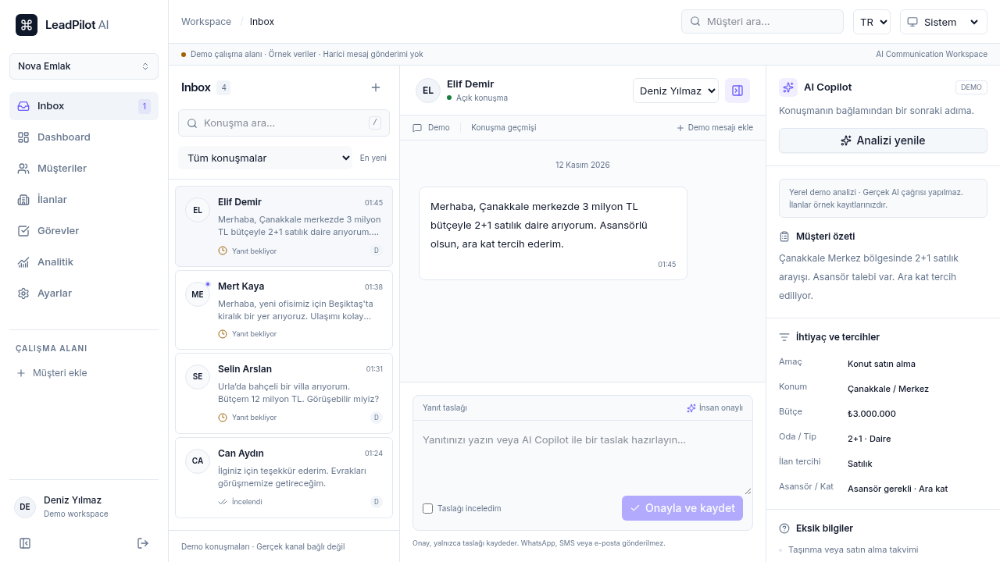
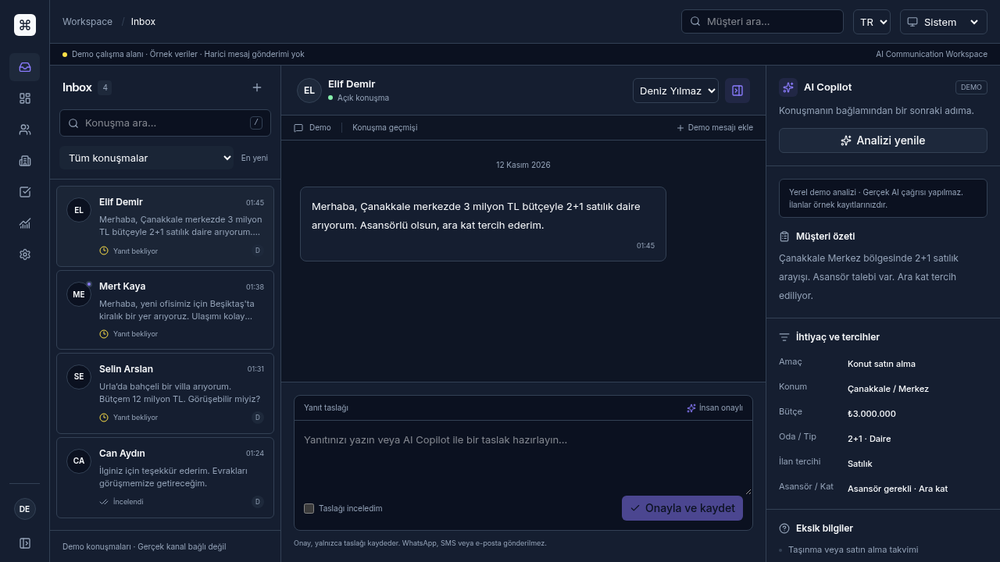

# LeadPilot AI

Emlak ofisleri için Inbox merkezli **AI Communication Workspace**. Mevcut CRM,
görev ve ekip yönetimi korunarak geliştirilmiştir.
Next.js App Router, React, TypeScript, Tailwind, shadcn/ui, Supabase ve OpenAI.
Tek uygulama mimarisi; mikroservis veya ödeme bağımlılığı yok.

## Bilgisayarınızda çalıştırma

Node.js **24 LTS**, npm **11** gerekir. Proje klasörünü VS Code ile açın.

Windows PowerShell terminalinde:

```text
npm.cmd ci
npm.cmd run dev
```

macOS/Linux terminalinde:

```bash
npm ci
npm run dev
```

`Ready` görünene kadar bekleyin ve terminali açık tutun.

Tarayıcıda `http://localhost:3000` açın. Landing sayfasından **Demoyu keşfet**
veya doğrudan `/inbox` yolunu kullanın. Varsayılan `APP_MODE=demo`:
API anahtarı, hesap, Supabase veya WhatsApp bağlantısı gerekmez.

İsteğe bağlı ortam dosyası:

```bash
cp .env.example .env.local
```

Windows PowerShell eşdeğeri: `Copy-Item .env.example .env.local`.
Var olan `.env.local` dosyanızı üzerine yazmayın. Gerçek değerleri Git'e eklemeyin.

## Özellikler ve çalışma modları

| Alan                                               | Demo                                | Canlı mod                                   |
| -------------------------------------------------- | ----------------------------------- | ------------------------------------------- |
| Landing, TR/EN, açık/koyu tema, mobil arayüz       | Çalışır                             | Çalışır                                     |
| Dashboard, müşteri CRUD, arama ve durum filtreleri | Tarayıcı oturumunda çalışır         | Supabase bağlantısı ve migration gerekir    |
| Görev oluşturma/tamamlama/silme, gecikme görünümü  | Çalışır                             | Supabase gerekir                            |
| AI analizi ve düzenlenebilir yanıt taslağı         | Yerel demo çıktısı; LLM çağrısı yok | OpenAI + Supabase gerekir                   |
| Taslak onayı ve tek takip görevi oluşturma         | Çalışır                             | Supabase üzerinde atomik RPC                |
| Profil/işletme ayarları ve JSON dışa aktarım       | Çalışır                             | Supabase gerekir                            |
| Kayıt/giriş, e-posta doğrulama, şifre sıfırlama    | Kimlik bilgisi toplamaz             | Supabase Auth/SMTP ayarları gerekir         |
| Çoklu işletme ve ekip rolleri                      | Örnek tek işletme                   | Üyelik kontrolü ve RLS ile Supabase gerekir |
| Ödeme/abonelik tahsilatı, WhatsApp bağlantısı      | Yok                                 | Bu sürümde entegrasyon yok                  |

**Bu sürüm hiçbir müşteriye mesaj göndermez.** Onay, taslağı kaydeder ve seçilirse
takip görevi açar. WhatsApp/e-posta/SMS gönderim API'si bulunmaz. Fiyatlandırma
kartları ürün planını gösterir; ödeme almaz.

Demo verileri yalnızca `sessionStorage` içindedir; sekme oturumu sonunda silinir.
Dil/tema tercihi `localStorage` içinde saklanır. Demo ekranlarına gerçek kişisel
veri girmeyin. Demo, canlı veri deposuna hiçbir yazma isteği yapmaz. Canlı modda
servis hatası oluşursa demo verilerine sessizce dönülmez.

## Kontroller

```bash
npm run lint
npm run typecheck
npm test
npx playwright install chromium
npm run test:e2e
npm run build
npm start
```

Playwright kendi sunucusunu varsayılan olarak **3100** portunda başlatır;
3000 portundaki geliştirme uygulamasını kapatmanız gerekmez. `E2E_PORT` ile değiştirilebilir. Production tarayıcı testi için build sonrası:

```bash
E2E_PRODUCTION=1 npm run test:e2e
```

PowerShell: `$env:E2E_PRODUCTION='1'; npm run test:e2e`.
Kurulu Chromium alternatif olarak `PLAYWRIGHT_CHROMIUM_EXECUTABLE_PATH` ile
seçilebilir. Bu bulut ortamında doğrulanan komut:

```bash
PLAYWRIGHT_CHROMIUM_EXECUTABLE_PATH=/usr/bin/chromium E2E_PRODUCTION=1 npm run test:e2e
```

Bulut ortamının kısıtlı kullanıcı dizininde npm önbelleği için
`npm_config_cache=/tmp/leadpilot-npm` kullanılabilir.

`npm test`, migration'ı PGlite'ın PostgreSQL motorunda çalıştırır. Auth şeması
ve JWT kullanıcı kimliği test fixture'ıdır; Supabase Cloud bağlantısının veya
SMTP teslimatının doğrulandığı anlamına gelmez. AI HTTP testleri sağlayıcıyı
mock'lar, ücretli OpenAI çağrısı yapmaz.

## Inbox ve görünüm

- Desktop'ta konuşma listesi, sohbet ve kapanabilir Copilot paneli.
- Tablet/mobilde erişilebilir drawer ve konuşma listesine geri dönüş.
- Kayıtlı ilan eşleştirmesi; olmayan ilan üretilmez.
- Müşteri ekleme/düzenleme ve takip görevi Inbox'tan ayrılmadan yapılabilir.
- Inter fontu self-host edilir; next-themes Light / Dark / System tercihini saklar.
- Dashboard ve Analytics gerçek kayıtları sayar; demo açıkça etiketlidir.

Ayrıntılar: [Inbox tasarım ve veri akışı](docs/inbox-redesign.md).





## Dosya yapısı

- `src/app`: sayfalar, Route Handlers ve sign-out Server Action.
- `src/features/workspace`: korunan CRM, görevler ve ortak veri sağlayıcısı.
- `src/features/inbox`: konuşmalar, Copilot, ilanlar ve analitik.
- `src/components`: ortak navigasyon, formlar, tema ve shadcn Button.
- `src/lib`: Zod şemaları, TR/EN sözlükleri, AI güvenlik doğrulaması.
- `src/lib/server`: sunucuya özel Supabase ve yetkilendirme sınırı.
- `supabase/migrations`: tablolar, ilişkiler, RLS, audit, atomik kota ve onay fonksiyonları.
- `tests`: masaüstü/mobil Playwright akışları.

[Mimari](docs/architecture.md) · [Servis/yayın rehberi](docs/deployment.md) ·
[Doğrulama raporu](docs/validation.md)

shadcn CLI registry erişimi ortamda engellendiğinden Button, resmi
`shadcn-ui/ui` GitHub kaynağından alındı; yalnızca cn ve eşdeğer Radix Slot
importları uyarlandı. `components.json` kayıtlıdır. Google Fonts yerine sistem
fontları kullanılır. Mevcut proje korunmuş, sıfırdan yeniden oluşturulmamıştır.
